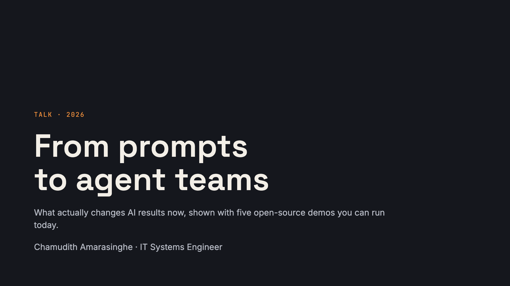

# From Prompts to Agent Teams

**What actually changes AI results now, shown with five open-source demos you can run today.**

Classic prompt talks teach phrases: give the model a persona, a recipe, a few examples, and ask it to think step by step. Today's models already reason on their own, so most of the gains now come from the system around the prompt. This talk walks through six practices, each with a working demo on made-up data.

| # | Practice | Demo |
|---|---|---|
| 1 | Context beats clever prompts: instructions files, skills and memory | [godfather](https://github.com/chamu262/claude-godfather) |
| 2 | Give it tools, read-only first | [poc.mcp-it-tools](https://github.com/chamu262/poc.mcp-it-tools) |
| 3 | Agents propose, people approve | [agentic-os-demo](https://github.com/chamu262/agentic-os-demo) |
| 4 | Rules decide, AI explains | [sample-agentic-access-review](https://github.com/chamu262/sample-agentic-access-review) |
| 5 | From one agent to a team | [nova-os-demo](https://github.com/chamu262/nova-os-demo) |
| 6 | Check the work, not the claim | [godfather](https://github.com/chamu262/claude-godfather) |

## Files

- [Presentation.pdf](Presentation.pdf): the 13 slides
- [SPEAKER-NOTES.md](SPEAKER-NOTES.md): what to say on each slide
- `preview.png`: the cover

## The one line to remember

> Write the system, not the sentence.
